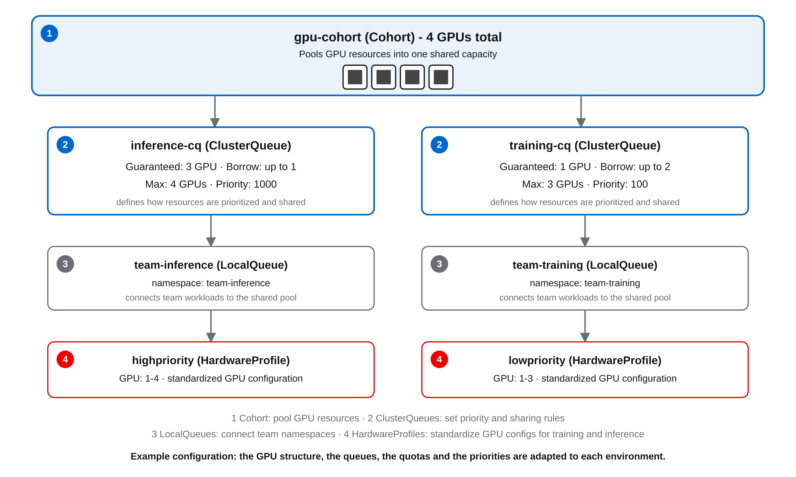

:toc:
:imagesdir: images
:_content-type: ASSEMBLY
include::modules/comm-attributes.adoc[]

[id="prerequisites"]
== Prerequisites

This pattern assumes that an OpenShift cluster is already available and ready to use. The pattern manages the required Red Hat OpenShift AI and Red Hat build of Kueue Operators through the Validated Patterns framework and configures the OpenShift AI components required by the solution, including Models as a Service.

The underlying GPU hardware, GPU drivers and device enablement, subscriptions and entitlements, the LLM model artifacts, and environment-specific credentials remain prerequisites and are outside the scope of the pattern.

The tested versions are listed under <<tested-environments,Tested environments>>.

[id="platform-and-tools"]
=== Platform and tools

* *Platform (already available):* An OpenShift cluster with GPU-capable worker nodes and the required GPU stack configured. The pattern installs and manages the required Red Hat OpenShift AI and Red Hat build of Kueue Operators and applies the OpenShift AI configuration required by the solution.
* *Models (already available):* The three models used by the pattern: Llama 3 8B Instruct (request classification), GPT-OSS-20B (simple requests) and Qwen3-32B (complex requests). The two answer models are exposed through Models as a Service (MaaS).
* *Grafana (already available):* A Grafana instance that can query the metrics of the cluster. The pattern provides the dashboards.
* *Command line interfaces:* The Red Hat OpenShift CLI (`+oc+`) and Podman must be installed. The `+pattern.sh+` script runs the container of the Validated Patterns framework with Podman, and the container includes the other tools needed for the installation, such as Helm.
* *Additional tools:* For the other tooling dependencies, see link:https://validatedpatterns.io/learn/quickstart/[Patterns quick start].

[id="accounts-and-access"]
=== Accounts and access

* *GitHub access:* A GitHub account, along with a personal access token that has repository read and write permissions.
* *Cluster access:* Cluster administrator access to the OpenShift cluster, because the pattern installs Operators and creates cluster-scoped resources such as queues and priority classes.
* *MaaS API key:* The API key used by the Smart Model Router to call the models through MaaS. It is not provided in the repository. You create and manage it on your side, according to the model you use, and store it as a Secret outside Git.

[id="glossary"]
== Glossary

* *{rh-ocp} (OCP):* An enterprise Kubernetes platform used to build, deploy and manage containerized applications at scale.
* *{rhoai} (RHOAI):* The platform used to serve models, run training and fine-tuning workloads, and expose model consumption to users.
* *GPU as a Service (GPUaaS):* A centralized service that exposes GPU resources as a shared pool across the organization, governed by policy.
* *Model as a Service (MaaS):* A centralized platform that exposes, consumes and governs AI models (self-hosted and external) through a single endpoint.
* *Red Hat build of Kueue:* The Kubernetes-native job queueing system on which GPU as a Service is built.
* *Cohort:* A group of ClusterQueues that share unused capacity, so that one queue can borrow resources that another queue does not currently use.
* *ClusterQueue:* A cluster-scoped queue that defines the guaranteed quota, borrowing limits, maximum capacity and priority of a class of workloads.
* *LocalQueue:* A namespaced queue that connects the workloads of a team to a ClusterQueue.
* *HardwareProfile:* A standardized GPU configuration (for example, a GPU range) that users select when deploying training or inference workloads.
* *ResourceFlavor:* Describes a type of resource (for example, a GPU model or a pool of nodes) that the queues can allocate.
* *Priority class:* Defines the relative priority of workloads, used to decide which ones are admitted first and which ones can be preempted.
* *Smart Model Router:* The component that classifies each request and selects the most suitable model. It works on two levels: simple requests are sent to a smaller model (GPT-OSS-20B) and complex requests to a larger one (Qwen3-32B). A classifier model (Llama 3 8B Instruct) takes the decision. In the repository it is delivered as a reference implementation: application configuration, Deployment, Service and Route.
* *llm-d:* A Kubernetes-native distributed inference framework that adds smart routing and KV cache-aware scheduling on top of vLLM.
* *vLLM:* The inference engine that serves the models.
* *KV cache:* The cached attention state of previously processed tokens. Reusing it avoids repeating the prefill computation and reduces latency.
* *Token:* The unit of text processed by a model. Token consumption is the main driver of AI costs and the unit that MaaS measures and limits.
* *GuideLLM:* A tool that generates inference workloads and measures serving performance (throughput, time to first token, inter-token latency) under configurable load.
* *LM Evaluation Harness (`+lm-eval+`):* A framework that evaluates the quality of a model on selected tasks and datasets.
* *Helm chart:* A package of parameterized Kubernetes manifests. Its default values can be overridden for each environment without changing the templates.
* *Argo CD application:* A GitOps resource that keeps a cluster in sync with a path of a Git repository. In this pattern, each Helm chart is deployed by one application.

[id="key-concepts"]
== Key concepts

This section describes the concepts that are specific to this pattern. For the general concepts of the Validated Patterns framework (Helm, values files, ClusterGroups, GitOps, secrets and shared values), see link:https://validatedpatterns.io/learn/about-validated-patterns/[Validated Patterns documentation].

[id="gpu-as-a-service-gpuaas"]
=== GPU as a Service (GPUaaS)

GPUaaS is a centralized service built on Red Hat build of Kueue. It exposes GPU resources as a shared pool across the organization and provides:

* Policy-driven access and quota management, to ensure fair resource allocation across teams and projects.
* Priority-based scheduling, to guarantee that critical workloads receive resources first.
* Dynamic capacity sharing: unused GPU resources can be borrowed and are automatically reclaimed when needed.
* Full visibility: who uses what, when and why.

The service is built from four components, as shown in the following diagram.

.GPU as a Service component hierarchy (example configuration)

[cols="1,1,5",options="header"]
|===
|# |Component |Purpose

|1
|Cohort
|Pools GPU resources into a shared capacity

|2
|ClusterQueues
|Define how resources are prioritized and shared

|3
|LocalQueues
|Connect team workloads to the shared pool

|4
|HardwareProfiles
|Standardize GPU configurations for training and inference

|===

The table below shows an example configuration, based on a cohort of 4 GPUs. It reflects the environment in which the pattern was tested. The structure of the GPUs, the queues, the quotas and the priorities depend on each environment and are meant to be adapted: the names and the values in this section are illustrative only.

[cols="1,1,1,1,1,4,3",options="header"]
|===
|Queue |Guaranteed |Borrow up to |Max |Priority |Local queue / namespace |HardwareProfile

|`+inference-cq+`
|3 GPU
|1
|4 GPUs
|1000
|`+team-inference+` / `+team-inference+`
|`+highpriority+` (1-4 GPUs)

|`+training-cq+`
|1 GPU
|2
|3 GPUs
|100
|`+team-training+` / `+team-training+`
|`+lowpriority+` (1-3 GPUs)

|===

In this example, inference workloads are guaranteed 3 of the 4 GPUs and can borrow the remaining one, while fine-tuning workloads are guaranteed 1 GPU and can borrow up to 2 more when inference does not use them. When inference needs its capacity back, the borrowed GPUs are reclaimed.

Priority is implemented with Kueue `+WorkloadPriorityClass+` objects (`+inference-priority+`, value 1000, and `+training-priority+`, value 100), which the hardware profiles reference together with the local queue of each team.

In the tested environment the cluster provides 12 NVIDIA A30 GPUs (6 nodes with 2 GPUs each), while the example cohort defines a nominal quota of 4 GPUs (3 for inference and 1 for training). The other GPUs are not part of the example. The quotas are logical: the ResourceFlavor selects every node that exposes an NVIDIA GPU.

The HardwareProfile accelerator display name is generic (`+NVIDIA GPU+`) in the default chart configuration. It can be adapted to reflect the actual GPU model available in the target environment without modifying the chart templates.

[id="model-as-a-service-maas"]
=== Model as a Service (MaaS)

MaaS provides one governance layer for all AI models. Models as a Service is enabled in the OpenShift AI configuration managed by the `+rhoai-config+` application.

MaaS provides three governance areas:

* *Access governance:* who can access which models.
* *Consumption governance:* subscriptions, quotas and rate limits.
* *Token governance:* measure, price and control every token.

The models are exposed as secure, controlled API endpoints through centralized gateways, with rate limiting and access control.

A request is processed as follows:

. The user generates an API key from the {rhoai} dashboard.
. The application sends a request to the MaaS endpoint. An `+AuthPolicy+` validates the token through an internal API.
. A `+TokenRateLimitPolicy+` enforces the limits and the request is routed to the model.
. The response is returned to the caller, governed, logged and rate-limited.

.MaaS request flow
image::maas-request-flow.png[MaaS request flow]

[id="smart-model-router-and-dynamic-model-selection"]
=== Smart Model Router and dynamic model selection

Traditional AI deployments rely on static model assignment: the same model serves every task. In this pattern, the Smart Model Router classifies each request and selects the most suitable model according to its complexity, balancing performance, cost and resource efficiency. The routing has two levels: simple requests are served by a smaller model, and only the requests classified as complex reach the larger one. This lowers AI costs, selects the best model for each task and reduces latency.

The Smart Model Router is delivered as the `+smart-model-router+` Helm chart (`+charts/all/smart-model-router/+`), which contains its application code and page, its settings, and the Deployment, Service and Route that expose it. The API key used to call the models through MaaS is not provided in the repository. You create and manage it on your side, according to the model you use, and store it as a Secret outside Git.

It is a reference implementation of this approach, created for the pattern. A classifier model (Llama 3 8B Instruct) labels each request as simple or complex. Simple requests are sent to GPT-OSS-20B and complex requests to Qwen3-32B, both through the MaaS endpoint. The classifier is called directly inside the cluster, while the two answer models are called through MaaS. If the classifier is unavailable, the router falls back to heuristics based on the length of the request and on complexity keywords (in English and Italian).

[id="llm-d"]
=== llm-d

llm-d is a Kubernetes-native distributed inference framework that optimizes how models are served at scale. It sits between the requests and the vLLM inference pods and provides:

* *Intelligent request routing:* each request goes to the best replica according to cache locality and runtime telemetry.
* *KV cache-aware scheduling:* previously computed context is reused to skip prefill computations and reduce latency.
* *Distributed inference scaling:* horizontal scaling across replicas and accelerators to handle high concurrency.

[id="observability"]
=== Observability

Observability is a centralized monitoring layer that provides real-time visibility into AI infrastructure, model consumption and operational performance. Usage, performance and GPU metrics are collected and visualized through Grafana dashboards. The pattern covers:

* *Model performance:* latency, throughput, error rates and quality.
* *Token consumption:* usage analytics, quotas and trends.
* *API and request metrics:* requests, responses and success/failure rates.
* *GPU utilization:* utilization, allocation, temperature and memory.
* *Training jobs status:* job tracking, duration, status and events.
* *Logging and audit:* centralized logs.

[id="automation-breakdown"]
== Automation breakdown

The repository is a Helm-based Validated Pattern. The cluster group values file acts as the software bill of materials for the target cluster: it declares the namespaces, required Operator subscriptions and Argo CD applications managed by the pattern.

The Red Hat OpenShift AI and Red Hat build of Kueue Operators are declared as subscriptions in `+variants/hub/values-hub.yaml+`. The `+rhoai-config+` application then applies the OpenShift AI configuration required by the pattern, including Models as a Service enablement. Kueue remains unmanaged by the OpenShift AI `+DataScienceCluster+` because it is installed and managed separately through the Red Hat build of Kueue Operator.

[cols="3,12",options="header"]
|===
|Path |Contents

|`+charts/all/rhoai-config/+`
|OpenShift AI configuration required by the pattern: DSCInitialization, DataScienceCluster and Models as a Service enablement.

|`+charts/all/gpuaas/+`
|GPU as a Service: Kueue ResourceFlavors, cohort, priority classes, ClusterQueues, LocalQueues and OpenShift AI HardwareProfiles.

|`+charts/all/gpuaas-monitoring/+`
|Kueue monitoring: ServiceMonitor, RBAC, dashboard and an optional cluster-wide monitoring configuration.

|`+charts/all/llm-d/+`
|Parameterized `+LLMInferenceService+` resources for the two answer models, provided as a reference. The model artifacts and environment-specific model configuration must be adapted to the target environment.

|`+charts/all/observability/+`
|Six Grafana dashboards, three ServiceMonitors and NVIDIA GPU Operator alert rules.

|`+charts/all/smart-model-router/+`
|Smart Model Router: code and page, settings, Deployment, Service and Route.

|`+values-global.yaml+`, `+variants/hub/values-hub.yaml+`
|Validated Patterns framework configuration: global settings, managed namespaces, required Operator subscriptions and the applications of the hub cluster group.

|`+Makefile+`, `+Makefile-common+`, `+pattern.sh+`
|Entry points of the framework, including `+./pattern.sh make install+` and the validation targets.

|`+.github/workflows/+`, `+scripts/+`
|Continuous validation: strict Helm lint and template for every chart, plus structure checks.

|`+training/+`
|Notebook for distributed fine-tuning with Kubeflow Trainer and Kueue.

|`+benchmarking/+`
|Documentation of the benchmarking and evaluation activities (GuideLLM and LM Evaluation Harness). It does not contain notebooks, commands, logs or results yet.

|`+HELM_CONFIGURATION.md+`, `+VALIDATED_PATTERN.md+`
|Reference for the chart values and for the Validated Pattern integration.

|===

[id="adapting-the-pattern-to-your-environment"]
== Adapting the pattern to your environment

The default values of the Helm charts reflect the environment and use case in which the pattern was tested. They are examples to adapt, not infrastructure requirements. Environment-specific values belong in separate values files or controlled Git commits, never in the chart templates, and credentials never belong in values.

[cols="5,6",options="header"]
|===
|What differs in your environment |Where to change it

|Teams and namespaces
|`+variants/hub/values-hub.yaml+`: `+clusterGroup.namespaces+`

|Number of GPUs, quotas and borrowing limits
|`+charts/all/gpuaas+`: `+clusterQueues[].resources.gpu+`

|Queue configuration
|`+charts/all/gpuaas+`: `+clusterQueues[]+`, `+localQueues[]+`

|Priorities
|`+charts/all/gpuaas+`: `+priorityClasses[]+`

|GPU node labels and tolerations
|`+charts/all/gpuaas+`: `+resourceFlavors[]+`

|GPU type and ranges offered by the hardware profiles
|`+charts/all/gpuaas+`: `+hardwareProfiles.items[].identifiers[]+`

|Models: URI, replicas, GPUs per replica and vLLM arguments
|`+charts/all/llm-d+`: `+models.<model>+`

|Endpoints and model identifiers of the router
|`+charts/all/smart-model-router+`: `+maas+`, `+models+` and `+classifier+`

|Monitoring objects whose target workloads, namespaces or metrics services do not exist
|`+enabled+` flags in `+charts/all/observability+` and `+charts/all/gpuaas-monitoring+`

|===

[id="gpus-with-a-different-amount-of-memory"]
=== GPUs with a different amount of memory

Kueue counts GPUs as devices, not gigabytes: the memory of a GPU does not appear in the queues. Whether a model fits depends on values of the `+llm-d+` chart: the number of GPUs per replica, the vLLM arguments (`+--tensor-parallel-size+`, `+--max-model-len+` and `+--gpu-memory-utilization+`) and the model itself (`+uri+`).

The tested environment uses NVIDIA A30 GPUs. The GPU type displayed by the HardwareProfiles is configurable through the chart values and is not a requirement of the pattern.

As a rough guide, the weights of a model occupy about its number of parameters times the bytes per parameter (about 32 GB for a model of 32 billion parameters in FP8), plus the KV cache and some margin. With GPUs that have less memory, adapt together the GPUs per replica and the tensor parallelism, the maximum context length, or the model. If a model needs more GPUs per replica, review also the queue quotas and the maximum of the hardware profile.

[id="technical-requirements"]
== Technical requirements

[source,text]
----
Source code repository: https://github.com/acicrome/ai-optimization.git
branch: validated-pattern
----

The Helm configuration of the pattern is currently available in the `+validated-pattern+` branch of the repository. Use that branch until a dedicated location for the pattern is defined.

[id="tested-environments"]
=== Tested environments

[cols="1,2",options="header"]
|===
|Component |Tested environment

|{rh-ocp}
|4.20.22

|{rhoai}
|3.4.1

|Infrastructure
|Dell APEX

|Cluster
|6 nodes, each with 2 NVIDIA A30 GPUs (12 GPUs in total)

|===

OpenShift 4.20 is within the OpenShift versions supported by the tested OpenShift AI environment.

[id="network-requirements"]
=== Network requirements

For connected environments:

. Access to public container registries.
. Access to GitHub repositories.
. Access to `+quay.io+`, from which `+pattern.sh+` pulls the container image of the framework, and to the Validated Patterns Helm chart repository (`+charts.validatedpatterns.io+`).
. Access to the Operator catalogs required to install the Red Hat OpenShift AI and Red Hat build of Kueue Operators.

[id="security-considerations"]
=== Security considerations

* Do not commit passwords, access tokens, private keys or other secrets in plaintext.
* Manage credentials through Kubernetes/OpenShift Secrets or a dedicated secret-management solution.
* Avoid hardcoding environment-specific hostnames, addresses and parameters when they can be managed through environment-specific configuration.
* The charts do not render the MaaS API key Secret. The MaaS API key of the Smart Model Router is not provided in the repository: you create and manage it on your side, according to the model you use, and store it as a Secret outside Git.

[id="sizing-of-the-hub-cluster"]
=== Sizing of the hub cluster

[cols="1,1",options="header"]
|===
|Resource |Value

|Nodes
|6

|GPUs per node
|2 x NVIDIA A30

|GPUs in total
|12

|===

The sizing above describes the environment used to test the pattern and is not a fixed infrastructure requirement. GPU capacity, quotas and model sizing must be adapted to the target environment.

[id="consuming-a-pattern"]
== Consuming a pattern

.Procedure
. Make sure that the OpenShift cluster and GPU infrastructure described in the prerequisites are available.
. Install the OpenShift CLI, available at link:https://console.redhat.com/openshift/downloads[Red Hat OpenShift downloads], and Podman.
. Log in to the OpenShift cluster. The `+KUBECONFIG+` file must be below your home directory, because `+pattern.sh+` mounts it into the container of the framework:
+
[source,terminal]
----
$ oc login --token=<API token> --server=<API URL:6443>
----

. From the pattern repository on GitHub, click the *Fork* button.
. Clone the forked copy of the repository:
+
[source,terminal]
----
$ git clone git@github.com:<your-github-user>/ai-optimization.git
----

. Navigate to the root directory of your repository:
+
[source,terminal]
----
$ cd /path/to/your/repository
----

. Set the upstream repository. The `+-f+` option also fetches the branches of the upstream repository, including `+validated-pattern+`, which contains the Helm configuration of the pattern:
+
[source,terminal]
----
$ git remote add -f upstream https://github.com/acicrome/ai-optimization.git
----

. Verify the setup of your remote repositories:
+
[source,terminal]
----
$ git remote -v
----

. Create a working branch from the `+validated-pattern+` branch of the upstream repository:
+
[source,terminal]
----
$ git switch -c my-branch upstream/validated-pattern
----

. Review the pattern values and adapt them to your environment (see <<adapting-the-pattern-to-your-environment,Adapting the pattern to your environment>>). In particular:
* match the Kueue quotas, GPU node labels, queue namespaces and HardwareProfiles to the real capacity of the cluster;
* adapt the GPU display name in the HardwareProfiles if you want it to reflect the GPU model available in the target environment;
* replace the placeholder endpoints and model identifiers of the Smart Model Router (`+maas.url+`, `+models+` and `+classifier+` in the chart values);
* configure the `+llm-d+` model values according to the model artifacts, number of GPUs per replica and serving configuration available in the target environment;
* decide whether to enable the cluster-wide monitoring configuration of the `+gpuaas-monitoring+` chart: it updates the `+cluster-monitoring-config+` ConfigMap of `+openshift-monitoring+` and has a cluster-wide effect, so disable it if that configuration is managed elsewhere;
* disable the observability objects whose target workloads, namespaces or metrics services do not exist.

. Optional: Validate the charts before the installation. The validation runs strict `+helm lint+` and `+helm template+` checks for the pattern charts.
+
[source,terminal]
----
$ ./pattern.sh make validate
----

. Create the Secret with your MaaS API key, outside Git, in the `+smart-model-router+` namespace. The key is not provided in the repository: you create and manage it on your side, according to the model you use.
+
[source,terminal]
----
$ oc create secret generic smart-router-maas-credentials \
    --namespace smart-model-router \
    --from-literal=MAAS_API_KEY='<api-key>'
----

. Commit your environment-specific changes and push them to your fork:
+
[source,terminal]
----
$ git add .
$ git commit -m "Adapt the pattern values to my environment"
$ git push -u origin my-branch
----

. Install the pattern. The installation sets up {rh-gitops-short} (Argo CD) and the {validated-patterns-op}. The Validated Patterns framework manages the namespaces and installs the required Red Hat OpenShift AI and Red Hat build of Kueue Operators from the subscriptions declared in `+variants/hub/values-hub.yaml+`. The `+rhoai-config+` application then applies the OpenShift AI configuration required by the pattern, including Models as a Service enablement.
+
[source,terminal]
----
$ export TARGET_ORIGIN=https://github.com/<your-github-user>/ai-optimization.git
$ export TARGET_BRANCH=my-branch
$ ./pattern.sh make install
----

. Wait for the six Argo CD applications (`+rhoai-config+`, `+gpuaas+`, `+gpuaas-monitoring+`, `+llm-d+`, `+observability+` and `+smart-model-router+`) to synchronize.

.Verification
[source,terminal]
----
$ oc get subscriptions -A
$ oc get datasciencecluster,dscinitialization
$ oc get applications -A
$ oc get clusterqueues
$ oc -n smart-model-router rollout status deployment/smart-model-router
$ oc -n smart-model-router get pods,service,route
----

A synchronized application does not guarantee admission or scheduling. Check the Kueue status and actual GPU availability before running workloads.

[id="using-the-pattern-demo-use-case"]
== Using the pattern: demo use case

The demo use case shows the complete request lifecycle and the sharing of GPUs between inference and fine-tuning.

.End-to-end request flow
image::request-flow.png[End-to-end request flow]

*Request processing*

. A user submits a request through the AI application.
. The Smart Model Router classifies the request and selects the best model.
. The request is routed through the Model as a Service endpoint.
. llm-d optimizes the inference execution across the serving resources.
. The selected model generates the response.
. The response is returned to the user.

The demo uses two answer models that are available through the MaaS endpoint: Qwen3-32B (FP8 variant) for complex requests and GPT-OSS-20B for simple requests. The Smart Model Router uses a Llama 3 8B Instruct classifier to choose between them.

*GPU resource management*

* A shared GPU pool, provided by GPU as a Service, supports both inference and fine-tuning workloads.
* Priority-based scheduling ensures inference performance for production workloads.
* Fine-tuning jobs run at a lower priority and are safely preempted during resource contention.
* Checkpointing enables automatic recovery and resumption of the training activities.

*Fine-tuning example*

The `+training/+` directory contains a notebook that runs a distributed fine-tuning job from an OpenShift AI workbench with Kubeflow Trainer (`+TransformersTrainer+`). By default it fine-tunes a small model (`+Qwen/Qwen2.5-1.5B-Instruct+`) on a subset of 500 examples of the Stanford Alpaca dataset, with two training nodes of one GPU each, and it stores periodic and just-in-time checkpoints on a shared persistent volume. The job can be routed through a Kueue `+LocalQueue+` by setting the `+KUEUE_QUEUE_NAME+` environment variable. The notebook reads the cluster address and the token from environment variables and never stores them.

*Benchmarking and evaluation*

The project uses two complementary tools to evaluate the served models, Qwen3-32B and GPT-OSS-20B:

* *GuideLLM* measures serving performance under configurable load: request throughput, output-token throughput, time to first token, inter-token latency and behavior under concurrency.
* *LM Evaluation Harness (`+lm-eval+`):* evaluates the quality of the models on selected tasks and datasets.

Performance and quality results answer different questions, so they are reported separately. The `+benchmarking/+` directory documents the role of each tool and what to record for every run: model and revision, serving runtime, product versions and GPU configuration, workload and evaluation settings, timestamp and raw output, without credentials. Compare runs only when model, runtime, hardware and settings are sufficiently aligned. The documentation does not claim any particular performance or quality result.

*Observability*

Usage, performance and GPU metrics are visualized through Grafana dashboards: model performance, token consumption, API and request metrics, GPU utilization, training job status, and logging and audit.

[id="testing"]
== Testing

* *Verify the required Operators.* Confirm that the Red Hat OpenShift AI and Red Hat build of Kueue Operator subscriptions are installed and healthy.
+
[source,terminal]
----
$ oc get subscriptions -A
----

* *Verify the OpenShift AI configuration.* Confirm that `+default-dsci+` and `+default-dsc+` are present after the `+rhoai-config+` application synchronizes.
+
[source,terminal]
----
$ oc get datasciencecluster,dscinitialization
----

* *Verify the Argo CD applications.* Confirm that the six applications are synchronized and healthy.
+
[source,terminal]
----
$ oc get applications -A
----

* *Validate the charts.* Run the local validation. It runs strict `+helm lint+` and `+helm template+` checks for the pattern charts.
+
[source,terminal]
----
$ ./pattern.sh make validate
----

* *Verify the GPU as a Service configuration.* Confirm that the queues, ResourceFlavors and HardwareProfiles defined for your GPU structure exist and match the expected quotas and priorities.
+
[source,terminal]
----
$ oc get clusterqueues
$ oc get localqueues -A
----

* *Verify capacity sharing and preemption.* The names below are those of the example configuration. Run the fine-tuning notebook of the `+training/+` directory with `+KUEUE_QUEUE_NAME+` set to the training queue (`+team-training+`) and confirm that the job can use borrowed GPUs. Then submit inference workloads in the `+team-inference+` namespace and confirm that the fine-tuning job is preempted when inference needs its guaranteed capacity, and that it resumes from its last checkpoint when GPUs become available.
* *Verify the end-to-end flow.* Submit a request through the AI application and confirm that the Smart Model Router selects a model and that the response is returned through MaaS and llm-d.
* *Verify observability.* Open the Grafana dashboards and confirm that GPU utilization, token consumption, request metrics and training job status reflect the requests and jobs generated by the previous checks.
* *Verify that Kueue accounts for the model deployments.* Check that the model workloads appear among the Kueue workloads and that they are charged to the expected queue.
+
[source,terminal]
----
$ oc get workloads -A
----

* *Verify the Smart Model Router.* Check the rollout, then call the `+/health+` endpoint through the generated Route and send one simple and one complex request. The `+router+` field of the response reports the route and the model that were selected.
+
[source,terminal]
----
$ oc -n smart-model-router rollout status deployment/smart-model-router
$ oc -n smart-model-router get route smart-model-router
----
