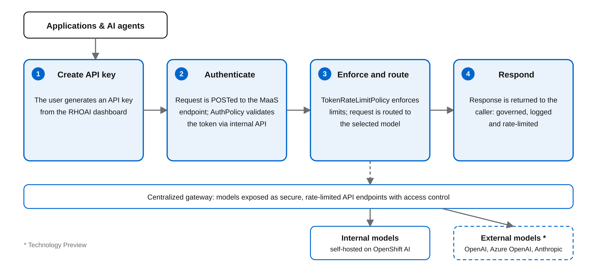
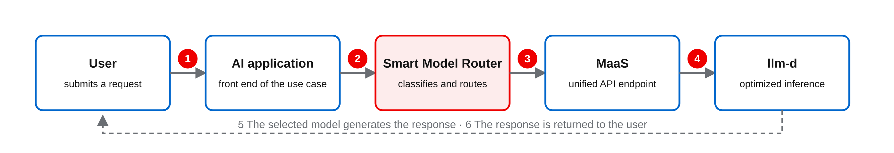

:toc:
:imagesdir: images
:_content-type: ASSEMBLY
include::modules/comm-attributes.adoc[]

[id="prerequisites"]
== Prerequisites

This pattern assumes that an OpenShift cluster is already available and ready to use.

The pattern manages the required Red Hat OpenShift AI and Red Hat build of Kueue Operators through the Validated Patterns framework and configures the OpenShift AI components required by the solution, including Models as a Service.

The underlying GPU hardware, GPU drivers and device enablement, subscriptions and entitlements, the LLM model artifacts, and environment-specific credentials remain prerequisites and are outside the scope of the pattern.

The tested versions are listed under <<tested-environments,Tested environments>>.

[id="platform-and-tools"]
=== Platform and tools

* *Platform (already available):* An OpenShift cluster with GPU-capable worker nodes and the required GPU stack configured. The pattern installs and manages the required Red Hat OpenShift AI and Red Hat build of Kueue Operators and applies the OpenShift AI configuration required by the solution.
* *Models (already available):* The three models used by the pattern: Llama 3 8B Instruct (request classification), GPT-OSS-20B (simple requests) and Qwen3-32B (complex requests). The two answer models are exposed through Models as a Service (MaaS).
* *Grafana (already available):* A Grafana instance that can query the metrics of the cluster. The pattern provides the dashboards.
* *Command line interfaces:* The Red Hat OpenShift CLI (`+oc+`) and Podman must be installed. The `+pattern.sh+` script runs the container of the Validated Patterns framework with Podman, and the container includes the other tools needed for the installation, such as Helm.
* *Additional tools:* For the other tooling dependencies, see link:https://validatedpatterns.io/learn/quickstart/[Patterns quick start].

[id="accounts-and-access"]
=== Accounts and access

* *GitHub access:* A GitHub account, along with a personal access token that has repository read and write permissions.
* *Cluster access:* Cluster administrator access to the OpenShift cluster, because the pattern installs Operators and creates cluster-scoped resources such as queues and priority classes.
* *MaaS API key:* The API key used by the Smart Model Router to call the models through MaaS. It is not provided in the repository. You create and manage it on your side, according to the model you use, and store it as a Secret outside Git.

[id="glossary"]
== Glossary

* *{rh-ocp} (OCP):* An enterprise Kubernetes platform used to build, deploy and manage containerized applications at scale.
* *{rhoai} (RHOAI):* The platform used to serve models, run training and fine-tuning workloads, and expose model consumption to users.
* *GPU as a Service (GPUaaS):* A centralized service that exposes GPU resources as a shared pool across the organization, governed by policy.
* *Model as a Service (MaaS):* A centralized platform that exposes, consumes and governs AI models through a single governed endpoint.
* *Red Hat build of Kueue:* The Kubernetes-native job queueing system on which GPU as a Service is built.
* *Cohort:* A group of ClusterQueues that share unused capacity, so that one queue can borrow resources that another queue does not currently use.
* *ClusterQueue:* A cluster-scoped queue that defines the guaranteed quota, borrowing limits, maximum capacity and priority of a class of workloads.
* *LocalQueue:* A namespaced queue that connects the workloads of a team to a ClusterQueue.
* *HardwareProfile:* A standardized GPU configuration that users select when deploying training or inference workloads.
* *ResourceFlavor:* Describes a type of resource, for example a GPU pool or group of GPU-capable nodes, that the queues can allocate.
* *Priority class:* Defines the relative priority of workloads, used to decide which ones are admitted first and which ones can be preempted.
* *Smart Model Router:* The component that classifies each request and selects the most suitable model. Simple requests are sent to GPT-OSS-20B and complex requests to Qwen3-32B. A Llama 3 8B Instruct classifier makes the routing decision.
* *llm-d:* A Kubernetes-native distributed inference framework that adds smart routing and KV cache-aware scheduling on top of vLLM.
* *vLLM:* The inference engine that serves the models.
* *KV cache:* The cached attention state of previously processed tokens. Reusing it avoids repeating prefill computation and reduces latency.
* *Token:* The unit of text processed by a model. Token consumption is the main driver of AI costs and the unit that MaaS measures and limits.
* *GuideLLM:* A tool that generates inference workloads and measures serving performance, including throughput, time to first token and inter-token latency.
* *LM Evaluation Harness (`+lm-eval+`):* A framework that evaluates model quality on selected tasks and datasets.
* *Helm chart:* A package of parameterized Kubernetes manifests. Default values can be overridden for each environment without modifying the chart templates.
* *Argo CD application:* A GitOps resource that keeps a cluster synchronized with a path in a Git repository.

[id="key-concepts"]
== Key concepts

This section describes concepts specific to this pattern. For general concepts of the Validated Patterns framework, including Helm, values files, ClusterGroups, GitOps, secrets and shared values, see link:https://validatedpatterns.io/learn/about-validated-patterns/[Validated Patterns documentation].

[id="gpu-as-a-service-gpuaas"]
=== GPU as a Service (GPUaaS)

GPUaaS is a centralized service built on Red Hat build of Kueue. It exposes GPU resources as a shared pool across the organization and provides:

* Policy-driven access and quota management to ensure fair resource allocation across teams and projects.
* Priority-based scheduling to ensure that critical workloads receive resources first.
* Dynamic capacity sharing, allowing unused GPU capacity to be borrowed and reclaimed when required.
* Visibility into GPU usage and allocation.

The service is built from four components, as shown in the following diagram.

.GPU as a Service component hierarchy (example configuration)
image::gpuaas-kueue.png[GPU as a Service component hierarchy (example configuration)]

[cols="1,1,5",options="header"]
|===
|# |Component |Purpose

|1
|Cohort
|Pools GPU resources into shared capacity

|2
|ClusterQueues
|Define how resources are prioritized and shared

|3
|LocalQueues
|Connect team workloads to the shared pool

|4
|HardwareProfiles
|Standardize GPU configurations for training and inference

|===

The following table shows an example configuration based on a cohort of 4 GPUs. It reflects the environment in which the pattern was tested.

The structure of the GPUs, queues, quotas and priorities depends on the target environment. The names and values in this section are illustrative and configurable.

[cols="1,1,1,1,1,4,3",options="header"]
|===
|Queue |Guaranteed |Borrow up to |Max |Priority |Local queue / namespace |HardwareProfile

|`+inference-cq+`
|3 GPUs
|1 GPU
|4 GPUs
|1000
|`+team-inference+` / `+team-inference+`
|`+highpriority+` (1-4 GPUs)

|`+training-cq+`
|1 GPU
|2 GPUs
|3 GPUs
|100
|`+team-training+` / `+team-training+`
|`+lowpriority+` (1-3 GPUs)

|===

In this example, inference workloads are guaranteed 3 of the 4 GPUs and can borrow the remaining GPU, while fine-tuning workloads are guaranteed 1 GPU and can borrow up to 2 additional GPUs when inference does not use them.

When inference requires its guaranteed capacity again, the borrowed GPUs can be reclaimed.

Priority is implemented with Kueue `+WorkloadPriorityClass+` objects (`+inference-priority+`, value 1000, and `+training-priority+`, value 100), which the HardwareProfiles reference together with the LocalQueue of each team.

In the tested environment, the cluster provides 12 NVIDIA A30 GPUs across 6 nodes with 2 GPUs per node. The example cohort defines a nominal quota of 4 GPUs: 3 for inference and 1 for training.

The remaining GPUs are not included in the example cohort. The quotas are logical and can be adapted to the target environment.

The default HardwareProfile uses the generic display name `+NVIDIA GPU+`. The displayed GPU type can be changed through the chart values to match the hardware available in the target environment without modifying the Helm templates.

[id="model-as-a-service-maas"]
=== Model as a Service (MaaS)

MaaS provides a governance layer for AI model consumption.

Models as a Service is enabled through the OpenShift AI configuration managed by the `+rhoai-config+` application.

MaaS provides three governance areas:

* *Access governance:* controls who can access which models.
* *Consumption governance:* manages subscriptions, quotas and rate limits.
* *Token governance:* measures and controls token consumption.

Models are exposed as controlled API endpoints through centralized gateways with rate limiting and access control.

A request is processed as follows:

. The user generates an API key from the {rhoai} dashboard.
. The application sends a request to the MaaS endpoint.
. An `+AuthPolicy+` validates access.
. A `+TokenRateLimitPolicy+` enforces the configured consumption limits.
. The request is routed to the selected model.
. The response is returned to the caller and its consumption is tracked.

.MaaS request flow

[id="smart-model-router-and-dynamic-model-selection"]
=== Smart Model Router and dynamic model selection

Traditional AI deployments frequently rely on static model assignment, where the same model serves every task.

In this pattern, the Smart Model Router classifies each request and selects the most suitable model according to its complexity, balancing performance, cost and resource efficiency.

The routing has two levels:

* Simple requests are served by GPT-OSS-20B.
* Complex requests are served by Qwen3-32B.

A Llama 3 8B Instruct classifier determines the routing decision.

The Smart Model Router is delivered through the `+smart-model-router+` Helm chart at `+charts/all/smart-model-router/+`. The chart contains the application code, configuration, Deployment, Service and Route.

The MaaS API key is not committed to the repository. It must be created as a Kubernetes Secret outside Git.

If the classifier is unavailable, the reference implementation falls back to heuristics based on request length and complexity keywords.

[id="llm-d"]
=== llm-d

llm-d is a Kubernetes-native distributed inference framework that optimizes how models are served at scale.

It sits between requests and the vLLM inference pods and provides:

* *Intelligent request routing:* each request is sent to the most appropriate replica based on cache locality and runtime telemetry.
* *KV cache-aware scheduling:* previously computed context can be reused to reduce repeated prefill computation and latency.
* *Distributed inference scaling:* requests can be distributed across replicas and accelerators to support higher concurrency.

[id="observability"]
=== Observability

Observability provides centralized visibility into AI infrastructure, model consumption and operational performance.

Usage, performance and GPU metrics are collected and visualized through Grafana dashboards.

The pattern covers:

* *Model performance:* latency, throughput, error rates and quality.
* *Token consumption:* usage analytics, quotas and trends.
* *API and request metrics:* requests, responses and success/failure rates.
* *GPU utilization:* utilization, allocation, temperature and memory.
* *Training job status:* job tracking, duration, status and events.
* *Logging and audit:* centralized logs.

[id="automation-breakdown"]
== Automation breakdown

The repository is a Helm-based Validated Pattern.

The cluster group values file acts as the software bill of materials for the target cluster. It declares the namespaces, required Operator subscriptions and Argo CD applications managed by the pattern.

The Red Hat OpenShift AI and Red Hat build of Kueue Operators are declared as subscriptions in `+variants/hub/values-hub.yaml+`.

The `+rhoai-config+` application applies the OpenShift AI configuration required by the pattern, including Models as a Service enablement.

Kueue remains unmanaged by the OpenShift AI `+DataScienceCluster+` because it is installed and managed separately through the Red Hat build of Kueue Operator. GPU queues and related resources are then configured by the `+gpuaas+` application.

[cols="3,12",options="header"]
|===
|Path |Contents

|`+charts/all/rhoai-config/+`
|OpenShift AI configuration required by the pattern: `+DSCInitialization+`, `+DataScienceCluster+` and Models as a Service enablement.

|`+charts/all/gpuaas/+`
|GPU as a Service: Kueue ResourceFlavors, cohort, priority classes, ClusterQueues, LocalQueues and OpenShift AI HardwareProfiles.

|`+charts/all/gpuaas-monitoring/+`
|Kueue monitoring: ServiceMonitor, RBAC, dashboard and optional cluster-wide monitoring configuration.

|`+charts/all/llm-d/+`
|Parameterized `+LLMInferenceService+` resources for the answer models. Model artifacts and environment-specific serving configuration must be adapted to the target environment.

|`+charts/all/observability/+`
|Grafana dashboards, ServiceMonitors and GPU-related alerting resources.

|`+charts/all/smart-model-router/+`
|Smart Model Router application, configuration, Deployment, Service and Route.

|`+values-global.yaml+`, `+variants/hub/values-hub.yaml+`
|Validated Patterns framework configuration containing global settings, managed namespaces, required Operator subscriptions and the applications of the hub cluster group.

|`+Makefile+`, `+Makefile-common+`, `+pattern.sh+`
|Validated Patterns framework entry points, including installation and validation targets.

|`+.github/workflows/+`, `+scripts/+`
|Continuous validation, including strict Helm linting, template rendering and structure checks.

|`+training/+`
|Notebook for distributed fine-tuning with Kubeflow Trainer and Kueue.

|`+benchmarking/+`
|Documentation for benchmarking and evaluation activities using GuideLLM and LM Evaluation Harness.

|`+HELM_CONFIGURATION.md+`, `+VALIDATED_PATTERN.md+`
|Reference documentation for Helm values and Validated Pattern integration.

|===

[id="adapting-the-pattern-to-your-environment"]
== Adapting the pattern to your environment

The default values provided by the pattern represent a validated reference configuration and are intended to be adapted to the target environment.

They are not fixed infrastructure, hardware or software-version requirements.

Environment-specific values belong in the appropriate values files or in controlled Git commits. Credentials and other sensitive information must never be stored in the repository.

[cols="5,6",options="header"]
|===
|What differs in your environment |Where to change it

|OpenShift AI and Kueue Operator channels
|`+variants/hub/values-hub.yaml+`: `+clusterGroup.subscriptions[].channel+`

|Teams and namespaces
|`+variants/hub/values-hub.yaml+`: `+clusterGroup.namespaces+`

|Number of GPUs, quotas and borrowing limits
|`+charts/all/gpuaas+`: `+clusterQueues[].resources.gpu+`

|Queue configuration
|`+charts/all/gpuaas+`: `+clusterQueues[]+`, `+localQueues[]+`

|Priorities
|`+charts/all/gpuaas+`: `+priorityClasses[]+`

|GPU node labels and tolerations
|`+charts/all/gpuaas+`: `+resourceFlavors[]+`

|GPU type and ranges offered by the HardwareProfiles
|`+charts/all/gpuaas+`: `+hardwareProfiles.items[].identifiers[]+`

|Models: URI, replicas, GPUs per replica and vLLM arguments
|`+charts/all/llm-d+`: `+models.<model>+`

|MaaS endpoint and model identifiers used by the Smart Model Router
|`+charts/all/smart-model-router+`: `+maas+`, `+models+` and `+classifier+`

|Monitoring objects whose target workloads, namespaces or metrics services do not exist
|`+enabled+` flags in `+charts/all/observability+` and `+charts/all/gpuaas-monitoring+`

|===

The Operator channels declared in `+variants/hub/values-hub.yaml+` are default values for the pattern, not universal requirements.

The Operator version installed on a target cluster is resolved from the configured subscription channel and the Operator catalog available to that cluster.

Before changing an Operator channel, verify compatibility between the target OpenShift version, the selected Operator version, and the API versions and custom resources used by the pattern.

[id="gpus-with-a-different-amount-of-memory"]
=== GPUs with a different amount of memory

Kueue counts GPUs as devices rather than gigabytes of GPU memory. GPU memory therefore does not appear directly in the queue quotas.

Whether a model fits on the available hardware depends on the `+llm-d+` chart configuration, including:

* the number of GPUs per replica;
* `+--tensor-parallel-size+`;
* `+--max-model-len+`;
* `+--gpu-memory-utilization+`;
* the model itself.

The tested environment uses NVIDIA A30 GPUs. This is the hardware used for validation and is not a requirement of the pattern.

The GPU type displayed by the HardwareProfiles is configurable through the chart values. GPU node selectors, quotas and model sizing must also be adapted to the actual target environment.

As a rough guide, model weights require approximately the number of parameters multiplied by the number of bytes used per parameter, in addition to KV cache and runtime overhead.

For GPUs with less memory, consider adapting the number of GPUs per replica, tensor parallelism, maximum context length or model size.

If a model requires more GPUs per replica, also review the Kueue quotas and HardwareProfile maximum values.

[id="technical-requirements"]
== Technical requirements

[source,text]
----
Source code repository: https://github.com/acicrome/ai-optimization.git
branch: validated-pattern
----

The Helm-based Validated Pattern configuration is currently available in the `+validated-pattern+` branch.

[id="tested-environments"]
=== Tested environments

[cols="1,2",options="header"]
|===
|Component |Tested environment

|{rh-ocp}
|4.20.22

|{rhoai}
|3.4.1

|Infrastructure
|Dell APEX

|Cluster
|6 nodes, each with 2 NVIDIA A30 GPUs (12 GPUs in total)

|===

The versions and infrastructure listed above describe the environment in which the pattern was validated and are not fixed installation requirements.

The pattern defines default Operator subscription channels in `+variants/hub/values-hub.yaml+`. These channels can be adapted to the target environment.

The Operator version actually installed is resolved from the configured subscription channel and the Operator catalog available to the target cluster.

Before deploying the pattern with different Operator channels or product versions, verify compatibility between the target OpenShift version, the selected Operators, and the API versions and custom resources used by the pattern.

Similarly, NVIDIA A30 represents the GPU hardware used in the tested environment and is not a hardware requirement. GPU type, node labels, quotas, HardwareProfile settings and model sizing are configurable for the target environment.

[id="network-requirements"]
=== Network requirements

For connected environments:

. Access to public container registries.
. Access to GitHub repositories.
. Access to `+quay.io+`, from which `+pattern.sh+` pulls the Validated Patterns framework container image.
. Access to the Validated Patterns Helm chart repository at `+charts.validatedpatterns.io+`.
. Access to the Operator catalogs required to install Red Hat OpenShift AI and Red Hat build of Kueue.

[id="security-considerations"]
=== Security considerations

* Do not commit passwords, access tokens, private keys, MaaS API keys or other secrets in plaintext.
* Manage credentials through Kubernetes/OpenShift Secrets or a dedicated secret-management solution.
* Avoid hardcoding environment-specific hostnames, addresses and parameters when they can be managed through environment-specific configuration.
* The charts do not render the MaaS API key Secret. The Smart Model Router MaaS API key must be created and managed outside Git.

[id="sizing-of-the-hub-cluster"]
=== Sizing of the hub cluster

[cols="1,1",options="header"]
|===
|Resource |Tested environment

|Nodes
|6

|GPUs per node
|2 x NVIDIA A30

|GPUs in total
|12

|===

The sizing above describes the environment used to test the pattern and is not a fixed infrastructure requirement.

GPU capacity, quotas and model sizing must be adapted to the target environment.

[id="consuming-a-pattern"]
== Consuming a pattern

.Procedure
. Make sure that the OpenShift cluster and GPU infrastructure described in the prerequisites are available.
. Install the OpenShift CLI, available at link:https://console.redhat.com/openshift/downloads[Red Hat OpenShift downloads], and Podman.
. Log in to the OpenShift cluster. The `+KUBECONFIG+` file must be available below your home directory because `+pattern.sh+` mounts it into the Validated Patterns framework container.
+
[source,terminal]
----
$ oc login --token=<API token> --server=<API URL:6443>
----

. From the pattern repository on GitHub, click the *Fork* button.
. Clone the forked repository:
+
[source,terminal]
----
$ git clone git@github.com:<your-github-user>/ai-optimization.git
----

. Navigate to the repository:
+
[source,terminal]
----
$ cd /path/to/your/repository
----

. Set the upstream repository. The `+-f+` option also fetches the upstream branches, including `+validated-pattern+`.
+
[source,terminal]
----
$ git remote add -f upstream https://github.com/acicrome/ai-optimization.git
----

. Verify the remote repositories:
+
[source,terminal]
----
$ git remote -v
----

. Create a working branch from the upstream `+validated-pattern+` branch:
+
[source,terminal]
----
$ git switch -c my-branch upstream/validated-pattern
----

. Review the pattern values and adapt them to your environment. See <<adapting-the-pattern-to-your-environment,Adapting the pattern to your environment>>. In particular:
* verify that the configured OpenShift AI and Kueue Operator channels are appropriate for the target OpenShift environment;
* match Kueue quotas, GPU node labels, queue namespaces and HardwareProfiles to the real capacity of the cluster;
* adapt the HardwareProfile GPU display name if required;
* replace the placeholder MaaS endpoint and Smart Model Router model identifiers;
* configure the `+llm-d+` model values according to the available model artifacts, GPU capacity and serving configuration;
* decide whether to enable cluster-wide monitoring configuration through `+gpuaas-monitoring+`;
* disable observability objects whose target workloads, namespaces or metrics services are not available in the target environment.

. Optional: Validate the charts before installation.
+
[source,terminal]
----
$ ./pattern.sh make validate
----

. Create the Secret containing the MaaS API key outside Git in the `+smart-model-router+` namespace:
+
[source,terminal]
----
$ oc create secret generic smart-router-maas-credentials \
    --namespace smart-model-router \
    --from-literal=MAAS_API_KEY='<api-key>'
----

. Commit the environment-specific changes and push them to your fork:
+
[source,terminal]
----
$ git add .
$ git commit -m "Adapt the pattern values to my environment"
$ git push -u origin my-branch
----

. Install the pattern. The installation sets up {rh-gitops-short} (Argo CD) and the {validated-patterns-op}. The Validated Patterns framework manages the declared namespaces and installs the required Red Hat OpenShift AI and Red Hat build of Kueue Operators from the subscriptions defined in `+variants/hub/values-hub.yaml+`. The `+rhoai-config+` application applies the OpenShift AI configuration required by the pattern, including Models as a Service enablement.
+
[source,terminal]
----
$ export TARGET_ORIGIN=https://github.com/<your-github-user>/ai-optimization.git
$ export TARGET_BRANCH=my-branch
$ ./pattern.sh make install
----

. Wait for the six Argo CD applications (`+rhoai-config+`, `+gpuaas+`, `+gpuaas-monitoring+`, `+llm-d+`, `+observability+` and `+smart-model-router+`) to synchronize.

.Verification
[source,terminal]
----
$ oc get subscriptions -A
$ oc get datasciencecluster,dscinitialization
$ oc get applications -A
$ oc get clusterqueues
$ oc -n smart-model-router rollout status deployment/smart-model-router
$ oc -n smart-model-router get pods,service,route
----

A synchronized application does not guarantee workload admission or scheduling. Verify Kueue status and actual GPU availability before running workloads.

[id="using-the-pattern-demo-use-case"]
== Using the pattern: demo use case

The demo use case shows the complete request lifecycle and the sharing of GPUs between inference and fine-tuning.

.End-to-end request flow

*Request processing*

. A user submits a request through the AI application.
. The Smart Model Router classifies the request and selects the most suitable model.
. The request is routed through the Model as a Service endpoint.
. llm-d optimizes inference execution across the serving resources.
. The selected model generates the response.
. The response is returned to the user.

The demo uses Qwen3-32B for complex requests and GPT-OSS-20B for simple requests through the MaaS endpoint. The Smart Model Router uses a Llama 3 8B Instruct classifier to choose between the two answer models.

*GPU resource management*

* A shared GPU pool provided by GPU as a Service supports inference and fine-tuning workloads.
* Priority-based scheduling gives inference workloads higher priority.
* Fine-tuning jobs run at lower priority and can be preempted during resource contention.
* Checkpointing enables recovery and resumption of fine-tuning activities.

*Fine-tuning example*

The `+training/+` directory contains a notebook that runs a distributed fine-tuning job from an OpenShift AI workbench with Kubeflow Trainer (`+TransformersTrainer+`).

By default, it fine-tunes `+Qwen/Qwen2.5-1.5B-Instruct+` on a subset of 500 examples from the Stanford Alpaca dataset, using two training nodes with one GPU each.

The job stores periodic and just-in-time checkpoints on a shared persistent volume.

The job can be routed through a Kueue `+LocalQueue+` by setting the `+KUEUE_QUEUE_NAME+` environment variable.

The notebook reads the cluster address and token from environment variables and does not store them.

*Benchmarking and evaluation*

The project uses two complementary tools to evaluate the served models:

* *GuideLLM* measures serving performance under configurable load, including request throughput, output-token throughput, time to first token, inter-token latency and concurrency behavior.
* *LM Evaluation Harness (`+lm-eval+`):* evaluates model quality on selected tasks and datasets.

Performance and quality results answer different questions and should therefore be reported separately.

The `+benchmarking/+` directory documents what should be recorded for every run, including model and revision, serving runtime, product versions, GPU configuration, workload settings, evaluation settings, timestamp and raw output.

Credentials must not be included in benchmark artifacts.

Runs should only be compared when model, runtime, hardware and settings are sufficiently aligned.

[id="testing"]
== Testing

* *Verify the required Operators.* Confirm that the Red Hat OpenShift AI and Red Hat build of Kueue Operator subscriptions are installed and healthy.
+
[source,terminal]
----
$ oc get subscriptions -A
----

* *Verify the OpenShift AI configuration.* Confirm that `+default-dsci+` and `+default-dsc+` are available after the `+rhoai-config+` application synchronizes.
+
[source,terminal]
----
$ oc get datasciencecluster,dscinitialization
----

* *Verify the Argo CD applications.* Confirm that all six applications are synchronized and healthy.
+
[source,terminal]
----
$ oc get applications -A
----

* *Validate the charts.* Run the pattern validation, which includes strict Helm linting and template rendering.
+
[source,terminal]
----
$ ./pattern.sh make validate
----

* *Verify the GPU as a Service configuration.* Confirm that the queues, ResourceFlavors and HardwareProfiles match the expected quotas, priorities and target GPU environment.
+
[source,terminal]
----
$ oc get clusterqueues
$ oc get localqueues -A
----

* *Verify capacity sharing and preemption.* Run the fine-tuning notebook from the `+training/+` directory with `+KUEUE_QUEUE_NAME+` set to `+team-training+`. Confirm that the workload can use borrowed GPU capacity. Then submit inference workloads in the `+team-inference+` namespace and verify that lower-priority fine-tuning workloads can be preempted when inference requires its guaranteed capacity and resume from the latest checkpoint when resources become available.

* *Verify the end-to-end flow.* Submit a request through the AI application and confirm that the Smart Model Router selects a model and that the response is returned through MaaS and llm-d.

* *Verify observability.* Open the Grafana dashboards and confirm that GPU utilization, token consumption, request metrics and training job status reflect generated requests and workloads.

* *Verify that Kueue accounts for model workloads.* Confirm that model workloads appear in Kueue and are associated with the expected queues.
+
[source,terminal]
----
$ oc get workloads -A
----

* *Verify the Smart Model Router.* Check its rollout and Route. Then send one simple request and one complex request and verify that the `+router+` field reports the expected route and selected model.
+
[source,terminal]
----
$ oc -n smart-model-router rollout status deployment/smart-model-router
$ oc -n smart-model-router get route smart-model-router
----
