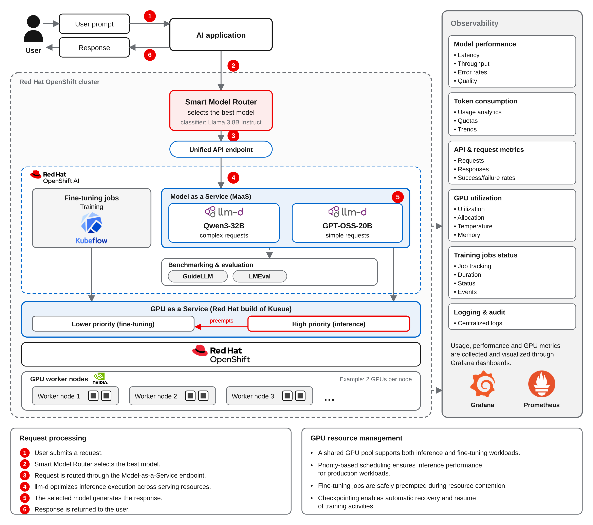

:toc:
:imagesdir: images
:_content-type: ASSEMBLY
include::modules/comm-attributes.adoc[]

[id="background"]
== Background

AI adoption is accelerating across the enterprise. More teams and applications consume AI services, which increases the demand for models, tokens, GPU resources and infrastructure capacity. Traditional operating models were not designed to govern AI resource consumption at this scale, and the growing complexity of AI workloads increases the need for hardware at a time of rising costs and limited availability.

Organizations typically face four operational challenges:

* *Limited GPU capacity.* GPU demand exceeds the available capacity. Resources are contended across teams and workloads, and critical workloads are delayed or blocked.
* *Rising AI costs.* Token consumption grows quickly and infrastructure spend increases across teams and models. AI-related costs are difficult to predict and control.
* *Unoptimized model selection.* The same model is often used for every task, with no criteria or routing logic to select the right one. Overpowered models increase latency and waste resources.
* *Limited visibility.* There is no end-to-end view of usage, costs and capacity, which makes it hard to plan, forecast or optimize, and leaves teams and applications without accountability.

Balancing cost, capacity, model efficiency and visibility requires a new approach to AI governance and optimization.

The Optimizing AI Infrastructure pattern addresses these challenges with a dual-layer strategy:

* *Infrastructure optimization* governs AI resources: budget governance, resource prioritization, access control, consumption visibility and tracking, and capacity planning.
* *Application optimization* optimizes AI consumption: cost-aware inference, model selection, intelligent routing, performance optimization and inference orchestration.

[id="key-features"]
== Key features

* *GPU as a Service (GPUaaS):* delivers GPUs as a governed, shared service built on Red Hat build of Kueue. It provides policy-driven quotas, priority-based scheduling, dynamic capacity sharing (borrow and reclaim) and tenant isolation.
* *Model as a Service (MaaS):* exposes the models through a single governed endpoint with access control, subscriptions, quotas, rate limits and token-level consumption governance.
* *Smart Model Router:* understands each request and routes it to the most suitable model for the task (a smaller model for simple requests and a larger one for complex requests), balancing performance, cost and resource efficiency.
* *llm-d runtime optimization:* a Kubernetes-native distributed inference framework that adds smart routing and KV cache-aware scheduling on top of vLLM pods, improving throughput, reducing latency and maximizing GPU efficiency.
* *Observability:* centralized visibility into GPU utilization, model performance, token consumption, request metrics, training job status and audit logs, exposed through Grafana dashboards.

[id="outcomes"]
== Outcomes

[cols="2,4",options="header"]
|===
|Outcome |What it means

|Lower costs
|Reduce waste and optimize AI spend

|Resource efficiency
|Right resources for the right priorities

|Full visibility
|End-to-end visibility and accountability

|Better governance
|Policy-driven control and compliance

|===

[id="solution-overview"]
== Solution overview

.Logical architecture

The pattern is organized in layers, from the consumers of AI services down to the GPU hardware:

. *Applications and AI agents* submit requests.
. The *Smart Model Router* classifies each request and selects the best model.
. The *Model as a Service* layer exposes the models through a unified endpoint and enforces access, consumption and token governance.
. *llm-d* optimizes inference execution across vLLM replicas.
. *GPU as a Service* provides a shared GPU pool, governed through Kueue queues and priorities, to inference and fine-tuning workloads.
. *Observability* spans all layers.

For architecture details, deployment instructions and testing, see link:getting-started[Getting started].

[id="next-steps"]
== Next steps

* link:getting-started[Getting started]
